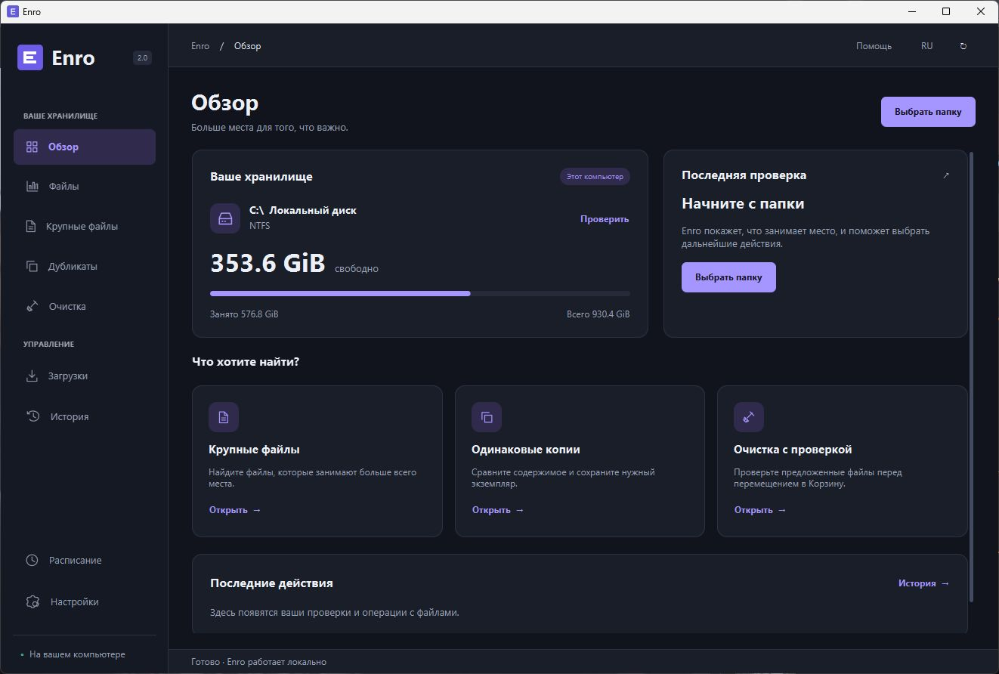
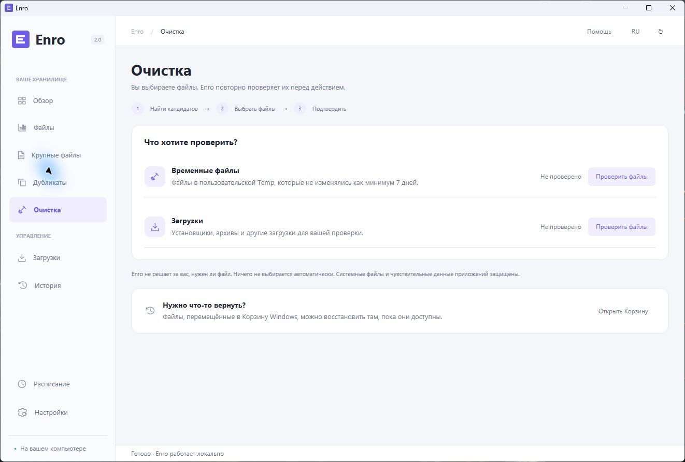
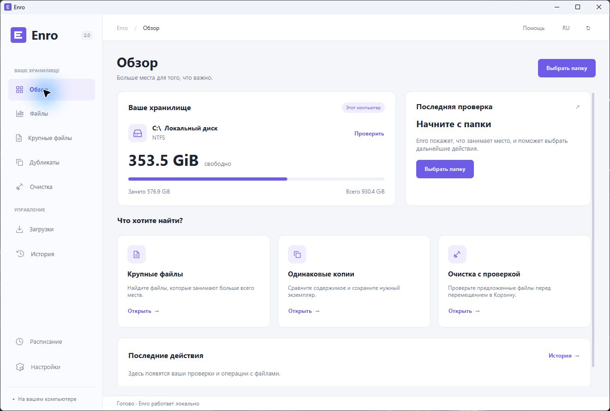

# Enro

### Больше места. Меньше сомнений.

Поймите, что занимает ваш диск. Сохраните важное. Остальное выберите сами.

**Приложение для Windows с картой файлов, поиском дубликатов и очисткой, которую контролируете вы.**

**Скачать:** [Windows EXE](https://github.com/Hollwestn/Enro/releases/download/v2.0.0/Enro-2.0.0.exe) · [Portable ZIP](https://github.com/Hollwestn/Enro/releases/download/v2.0.0/Enro-Portable-2.0.0-win-x64.zip) · [Windows MSI](https://github.com/Hollwestn/Enro/releases/download/v2.0.0/Enro-2.0.0.msi)

[Что скачать](docs/DOWNLOADS.md) · [Первый запуск](START_HERE.md) · [Руководство](USER_GUIDE.md) · [Все сборки](https://github.com/Hollwestn/Enro/releases)

Настоящее окно Enro. Показатели накопителя получены из Windows; история первого запуска пуста.

## Начните с ясной картины

Свободное место заканчивается, а нужные файлы разбросаны по папкам. Enro помогает понять, где находится объём: откройте каталог, посмотрите размеры, перейдите на карту и приблизьтесь к тому, что хотите проверить.

Вместо длинного списка непонятных «оптимизаций» — ваши файлы, их расположение и конкретное действие. Всё работает локально, без аккаунта и отправки содержимого на сервер.

| Задача | Что предлагает Enro |
|---|---|
| **Понять, куда ушло место** | Обзор реальных дисков, размеры каталогов и интерактивная Canvas-карта |
| **Найти крупное и старое** | Фильтры размера, типа и даты изменения, свойства, расположение в Проводнике |
| **Разобраться с копиями** | Сравнение содержимого, SHA-256 и побайтовая проверка, защищённый сохраняемый экземпляр |
| **Навести порядок в Загрузках** | Категории, дубликаты, предпросмотр перемещений и пакетного переименования |
| **Выбрать файлы для очистки** | Полные пути, причины, риск и отдельное подтверждение перед Корзиной |
| **Помнить, что изменилось** | Журнал операций, отмена неизменённых перемещений и переход к Корзине Windows |
| **Проверять регулярно** | Ежедневные/еженедельные задания и анализ при запуске, без автоматического удаления |

## От папки к решению — три шага

1. **Выберите папку.** Enro проверит её в фоне и сохранит результат. Ссылки и недоступные области учитываются как пропуски; проверку можно остановить.
2. **Посмотрите список или карту.** Начните с крупного, найдите одинаковое содержимое, проверьте полные пути и свойства.
3. **Подтвердите конкретные файлы.** Предпросмотр начинается с пустого выбора. Перед действием состояние каждого файла проверяется повторно.

## Вы решаете, что останется

Большой, старый или временный файл может быть нужен. Enro не считает возраст, размер или расширение достаточной причиной для удаления. В этой версии рекомендации требуют ручной проверки; системные и чувствительные каталоги защищены.

Для выбранных пользовательских файлов используется **Корзина Windows**. У Enro нет скрытого безвозвратного удаления или автоматического повышения прав. Перемещение в Корзину не гарантирует мгновенно освободившееся место; восстановление возможно, пока Windows хранит файл. [Как устроена защита →](SAFETY_GUIDE.md)

## Спокойный интерфейс — в вашем цвете

Постоянное боковое меню, понятные таблицы, быстрые действия рядом с выбранными файлами и единый стиль диалогов. Тёмная и светлая темы переключаются без перезапуска, как и русский/английский язык.

**Индиго** · **Мята** · **Серебро** · **Роза** · **Янтарь** · **Графит**

<strong>Посмотреть светлую тему</strong>

## Скачать и запустить

| Сборка | Когда выбрать |
|---|---|
| [**EXE — установщик**](https://github.com/Hollwestn/Enro/releases/download/v2.0.0/Enro-2.0.0.exe) | Обычная установка для текущего пользователя с ярлыком |
| [**Portable ZIP**](https://github.com/Hollwestn/Enro/releases/download/v2.0.0/Enro-Portable-2.0.0-win-x64.zip) | Распаковать всю папку и запустить Enro.exe без установки |
| [**MSI**](https://github.com/Hollwestn/Enro/releases/download/v2.0.0/Enro-2.0.0.msi) | Установка в формате Windows Installer |
| [**Исходники**](https://github.com/Hollwestn/Enro/releases/download/v2.0.0/Enro-Source-2.0.0.zip) | Сборка и изучение проекта |

**Java уже включена в готовые сборки.** Отдельный JDK нужен только для разработки. В portable оставьте рядом папки app/ и runtime/; настройки и история сохраняются в профиле пользователя.

Сборки не подписаны. Проверены на Windows 11 x64; Windows 10 и полный цикл установки/удаления на чистой машине пока не проверены. Контрольные суммы и точные результаты находятся в [Releases](https://github.com/Hollwestn/Enro/releases/tag/v2.0.0) и [отчёте](TEST_REPORT.md).

## Под капотом

| Слой | Технологии |
|---|---|
| Интерфейс | JavaFX 25.0.2, FXML, CSS, векторные иконки и Canvas |
| Анализ | Java 25, NIO, ограниченные фоновые задачи и потоковая обработка |
| Дубликаты | Размер → контрольные фрагменты → SHA-256 → побайтовая проверка |
| Хранение | SQLite JDBC, индексированные запросы, снимки и журнал операций |
| Windows | JNA, Windows File ID, Known Folders, IFileOperation для Корзины |
| Сборка | Maven Wrapper, JUnit 5, jlink и jpackage |

~~~powershell
git clone https://github.com/Hollwestn/Enro.git
cd Enro
# JAVA_HOME должен указывать на JDK 25
.\mvnw.cmd -B -ntp verify
.\mvnw.cmd javafx:run
~~~

Проверка ядра не требует запуска JavaFX. Локально выполнено **49 тестов: 48 успешно, 1 пропущен** из-за отсутствия права создания symbolic link. Windows-интеграция проверила собственные тестовые файлы, включая Корзину и восстановление. Автономная проверка комплектного EXE завершилась с **PASS**. [Разработка →](DEVELOPMENT.md) · [CI →](https://github.com/Hollwestn/Enro/actions/workflows/build.yml)

<strong>Границы текущей версии</strong>

- Размеры файлов — логические байты по путям, а не физическое выделение NTFS.
- Карта показывает текущую страницу до 350 непосредственных элементов; крупные/старые файлы — до 500 на страницу.
- Дубликаты: до 200 000 кандидатов, 20 000 файлов одного размера, 1000 групп. Неполный результат помечается явно.
- Temp/Downloads preview: до 5000 обычных файлов верхнего уровня. Нет универсальной очистки браузеров, Windows Update или WinSxS.
- Расписание действует при открытом Enro и только анализирует. Автоматическое удаление не реализовано.
- В Корзине восстанавливает Windows; в Enro отменяются неизменённые перемещения организатора. Собственного карантина нет.
- Многотерабайтные объёмы, все файловые системы и сценарии потери питания требуют дополнительной проверки.

## Документация

[Начать здесь](START_HERE.md) · [Установка](INSTALLATION.md) · [Работа с файлами](USER_GUIDE.md) · [Безопасность](SAFETY_GUIDE.md) · [Решение проблем](TROUBLESHOOTING.md) · [Архитектура](docs/ARCHITECTURE.md) · [Дизайн](docs/DESIGN_SYSTEM.md) · [Участие](CONTRIBUTING.md) · [История версий](CHANGELOG.md) · [Сторонние компоненты](THIRD_PARTY_NOTICES.md)

---

**Enro — пространство под вашим контролем.**

YOUR FILES. YOUR DECISION.

